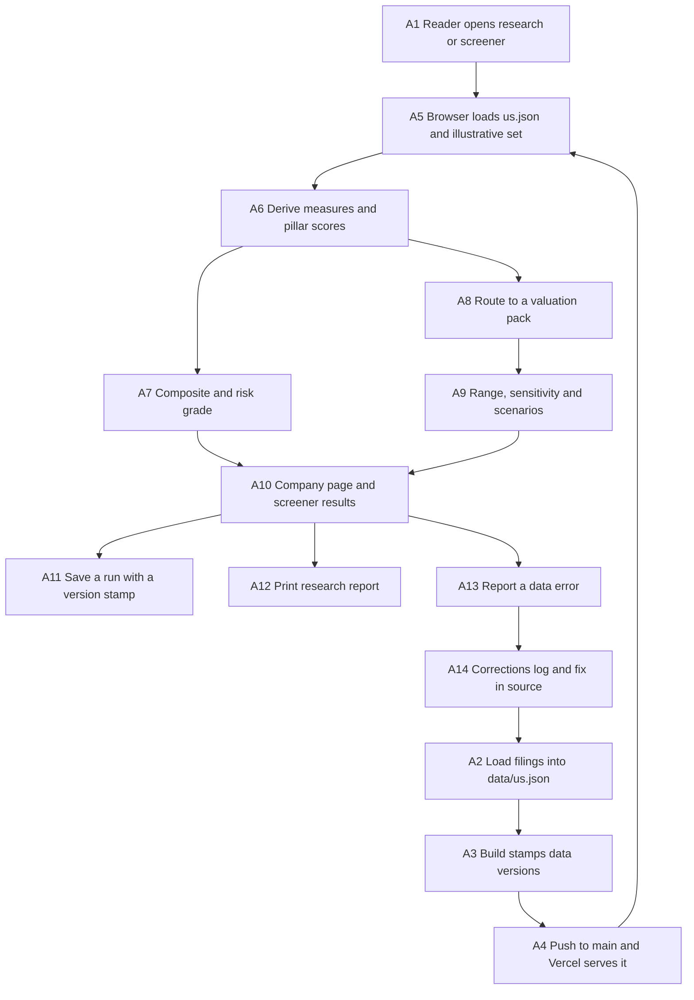
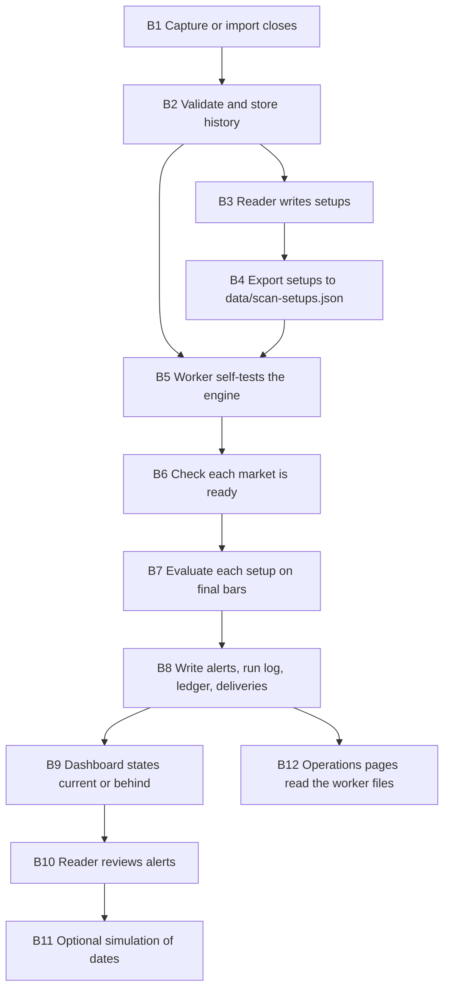
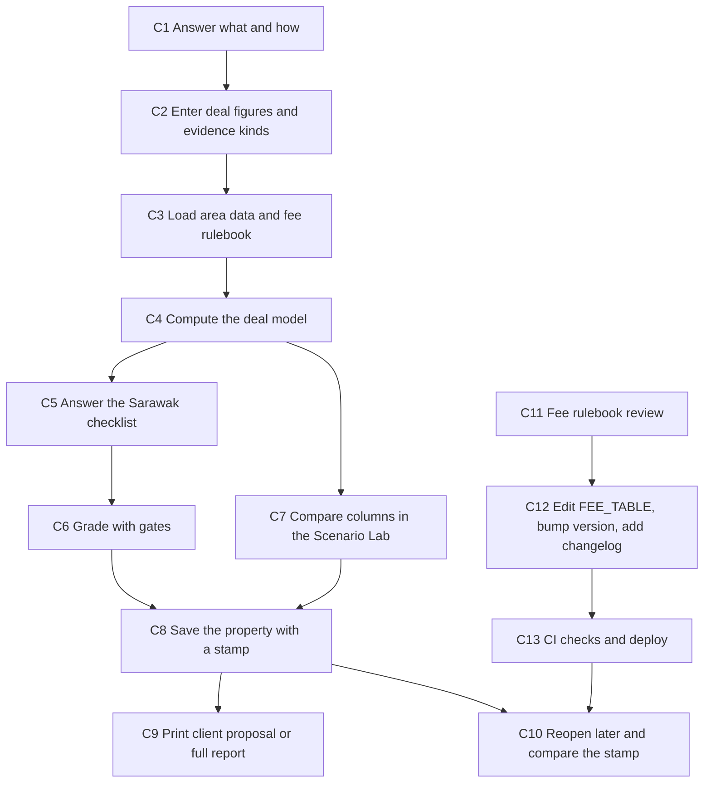

Internal research method notes. Not financial, investment or property advice.
Status: draft from repo, 27 Nov 2026
Last checked against code: 2818eba23

# Workflows

Three flowcharts, one per workflow. Under each chart a table gives, for every step, its trigger, its actor (person, cron or script), inputs, outputs and the file or route. "Cron" here means a scheduled run: GitHub Actions `schedule:` in `.github/workflows/journeys.yml`, or the Windows scheduled task that `ingest/schedule.ps1` registers. A step that the repository shows only as a command someone runs is marked person.

## (a) Research: question, sources, analysis, output

| Step | Trigger | Actor | Inputs | Outputs | File or route |
|---|---|---|---|---|---|
| A1 | The reader has a question about a company or a set of companies | person | a name, or screener criteria | the route opens | `/research`, `/discover/screener` (`src/js/35-ui.js`) |
| A2 | Refresh of filings is wanted; no schedule is shown in the repository (cadence: UNKNOWN - George to confirm [Q3]) | person runs a script | SEC EDGAR company facts; a contact string in the request header (`ingest/README.md`) | `data/us.json` (119 results, 0 failures at `generated 2026-08-03`); a gate refuses a smaller or degraded universe without `--force` | `ingest/sec.mjs` |
| A3 | A change to `src/` or `data/` | person or script runs the build | `src/js/*.js`, `data/` | hashes of versioned data files injected as `DATA_VERSIONS`; generated `index.html`, `pages/`, `assets/` | `build.mjs` (`dataVersions()`); CI re-checks with `node build.mjs --check` |
| A4 | A push to `main` | person pushes; Vercel deploys | committed files | served site; there is no build command and no workflow that deploys | `vercel.json`, `docs/release-gate.md` |
| A5 | The page opens | script in the reader's browser | `data/us.json`, `data/instruments.json`, the compiled illustrative set (`src/js/10-dataset.js`) | in-memory universe | `src/js/25-universe.js` |
| A6 | Each company is added to the universe | script in the browser | statement lines | measures (`src/js/13-metrics.js`), four pillar scores and Valuation Evidence | `src/js/15-derivation.js` (`scorePillar`), `src/js/25-universe.js:230` |
| A7 | A company page or a screener row is drawn | script in the browser | pillar scores, data completeness | composite over tested weight, classified only at 70% completeness or more; risk flags and High/Medium/Low | `researchComposite`, `riskFlags`, `riskGrade` (`src/js/15-derivation.js`) |
| A8 | The Valuation tab or the studio opens | script in the browser | business type, history | the model pack and editable defaults | `routeModel`, `defaultInputs` (`src/js/20-valuation.js`) |
| A9 | The reader moves a slider | person edits, script recomputes | assumptions | value per share range, sensitivity grid, driver ranking, bear and bull cases | `valuationRun`, `sensitivityGrid`, `SCENARIO_SHIFT`; `src/js/50-views-studio.js` |
| A10 | Steps A6 to A9 complete | script in the browser | all of the above | company page tabs; screener pass and fail lists with reasons | `src/js/45-views-research.js`, `src/js/40-views-discover.js` |
| A11 | The reader presses save | person | a run | a saved run with `buildStamp` (model, data hashes, as-of, illustrative flag); reopened later with "Model moved" or "Data moved" if either changed | browser storage; `src/js/15-derivation.js` |
| A12 | The reader opens the report route and prints | person | company, optionally `?run=<id>` | a printable page; PDF is the browser's print dialog | `/company/:id/report`, `src/js/47-report.js` |
| A13 | The reader sees an error | person | text of the report | a draft case `QT-YYYYMMDD-NNN-xxxx` in the browser; with a store configured, a receipt `QTR-<n>` after the store holds it | footer drawer (`src/js/65-learn.js`), `api/report.mjs`, `docs/report-submission.md` |
| A14 | A report is triaged | person | the report | a dated row on `/corrections` in the next release, then a fix in source, then A2 or A3 again | `src/js/65-learn.js` corrections log; `docs/launch-readiness/operator-runbook.md` section 3 |

## (b) Scanner: data, filters and scoring, results, review

The scanner scores nothing and ranks nothing: its "filter" is the reader's own rule tree, and its result is a record that conditions held (`src/js/86-scanner.js` header).

| Step | Trigger | Actor | Inputs | Outputs | File or route |
|---|---|---|---|---|---|
| B1 | Daily task, default 18:30 local time when registered with `ingest/schedule.ps1`; or by hand | cron on the owner's machine, or person | a watchlist page (screen capture and OCR), a provider quote or history, or an export with a volume column | review CSV, closes | `ingest/daily.mjs`, `ingest/watchlist.mjs`, `ingest/live.mjs`, `ingest/history-import.mjs`; whether the task is registered: UNKNOWN - George to confirm [Q6] |
| B2 | After B1 | script | closes | `data/price-history.json` (git-ignored) with bars validated, ranked, trimmed and dated; rejects to a separate file | `ingest/history-store.mjs`, `ingest-test`/`history-store-test` in CI |
| B3 | The reader builds a setup | person | indicator, operator, parameters, universe, timeframe | a setup in browser storage, versioned | `/app/scanner/setups/new`, `src/js/86-scanner.js` |
| B4 | The reader exports | person | saved setups | a document to save over `data/scan-setups.json`; the page reports when the file and the browser differ | `src/js/86-scanner.js` (export at about line 868), `scanner/setups.example.json` |
| B5 | Every worker run | script | the engine region cut from `index.html` | pass, or refuse to continue | `scanner/scan.mjs`, `src/js/24-market-engine.js` |
| B6 | With `--ready` (passed by `ingest/daily.mjs`) | script | capture times against each market's close plus settle margin (US 30 min, MY 30 min, FX 0) | markets not ready are SKIPPED_NO_DATA for the run and the run exits 2 | `SCAN_MARKETS` (`src/js/24-market-engine.js:104`) |
| B7 | After B6, one run at a time (lock file) | script | setups, history, optional watchlist export, price adjustments | matches on the last final bar; up to ten missed bars caught up | `scanner/scan.mjs` |
| B8 | End of run | script | matches | `data/scan-alerts.json`, `data/scan-runs.json` (newest 500 runs plus audit), `data/scan-ledger.json`, `data/scan-deliveries.json` (IN_APP only; email, Telegram, push recorded NOT_CONFIGURED) | `scanner/scan.mjs` |
| B9 | The dashboard opens | script in the browser | run log and alerts | one of current, behind, failed, paused, no run recorded, each reason dated | `/app/scanner`, `src/js/87-scanner-ops.js` |
| B10 | The reader opens alerts | person | alerts | values that made each condition hold; no ordering by strength | `/app/scanner/alerts` |
| B11 | The reader opens Historical | person | a setup, a date range | bars on which conditions held, with no entry, exit, cost or return | `/app/scanner/backtest`; `scan.mjs --backtest` |
| B12 | Someone opens `/admin/scanner` | person | the worker files of the serving machine | four read-only pages (data health, runs, delivery); redirected to `/` on the public `.vercel.app` host (`vercel.json`) | `/admin/scanner`, `src/js/87-scanner-ops.js` |

Exit codes of the worker: 0 completed, 1 failed, 2 partial, 3 skipped (paused, locked, no setups or no new data) (`scanner/scan.mjs` header).

## (c) Property: input, data, assessment, report

| Step | Trigger | Actor | Inputs | Outputs | File or route |
|---|---|---|---|---|---|
| C1 | The reader opens the Lab or the calculator | person | class (residential, commercial, land), route (new development, subsale, auction), optional objective | the questions set which model and which fee classes apply | `/property`, `/property/calculator`, `src/js/83-property-decision.js` (P1) |
| C2 | Same visit | person | price, rent, deposit, rate, tenure, vacancy, costs, hold, seller category; for each, where it came from | the deal, each figure badged by evidence kind | `PROPERTY_DEFAULT_DEAL` and `EVIDENCE` in `src/js/70-property.js`; a figure left at its default is an "illustrative default" |
| C3 | The model runs | script in the browser | `data/napic-h1-2025/<division>.json`, `data/sarawak-geo.json`, `data/sarawak-reach.json`, `FEE_TABLE`, `RPGT_SCHEDULE` | area evidence shown beside the deal (never scored into the grade); fee lines with provenance | `src/js/81-napic.js`, `src/js/77-property-reach.js`, `src/js/70-property.js` |
| C4 | Any input changes | script in the browser | the deal | loan, cash required, ledger, instalment, yields, DSCR, break-even occupancy, stress rows, exit and gains tax; auction and new-development models where chosen | `dealModel` (`src/js/75-property-grade.js:564`), `auctionModel`, `newDevModel` |
| C5 | The reader answers | person | yes, no or not sure for each question | settled, adverse or open per question | `SARAWAK_CHECKS` (`src/js/70-property.js:1767`) |
| C6 | After C4 and C5 | script in the browser | model and checklist | grade A, B, C, D or U, six pillar scores, coverage, named gates, with who can resolve each | `propertyGrade` (`src/js/75-property-grade.js:338`) |
| C7 | The reader moves sliders | person edits, script recomputes | up to three columns | the same model on each column; nothing ranked; nothing saved until a commit | `/property`, `src/js/82-property-lab.js` |
| C8 | Save | person | the deal | a saved property with `buildStamp('property')`, including the fee rulebook version | browser storage; `src/js/15-derivation.js:78` |
| C9 | The reader exports | person | a saved property | a printable client proposal or report (browser print); the Lab's export needs a saved property | `/property/models/:property/proposal`, `src/js/72-property-proposal.js` |
| C10 | A saved property is reopened | script in the browser | the stamp and the current build | "Current", "Fee rulebook moved", "Data moved" or "Fee rulebook and data moved" | `propertyStampDiff` (`src/js/15-derivation.js:149`) |
| C11 | Budget or gazette change; the rulebook's `nextReviewDue` is 2026-12-15 and its `reviewOwner` is null (reviewer: UNKNOWN - George to confirm [Q1]) | person | the cited official texts | a decision to change a line or not | `FEE_TABLE` (`src/js/70-property.js:1894`) |
| C12 | After C11 | person | the new rule | a new line value, `version` bumped, `checkedOn` and a `changelog` entry; a changelog row with `amounts: true` needs a matching row in the corrections log | `src/js/70-property.js`, `src/js/65-learn.js`; `model-test.mjs` pins version 1.5.0 (line 8732), so a bump needs that pin updated (see also the comment above `FEE_TABLE.changelog`) |
| C13 | A push to a branch or `main` | script (GitHub Actions on push; Vercel Git integration) | the commit | CI suites, then production serves it; saved properties then read "Fee rulebook moved" | `.github/workflows/checks.yml`, `vercel.json` |
